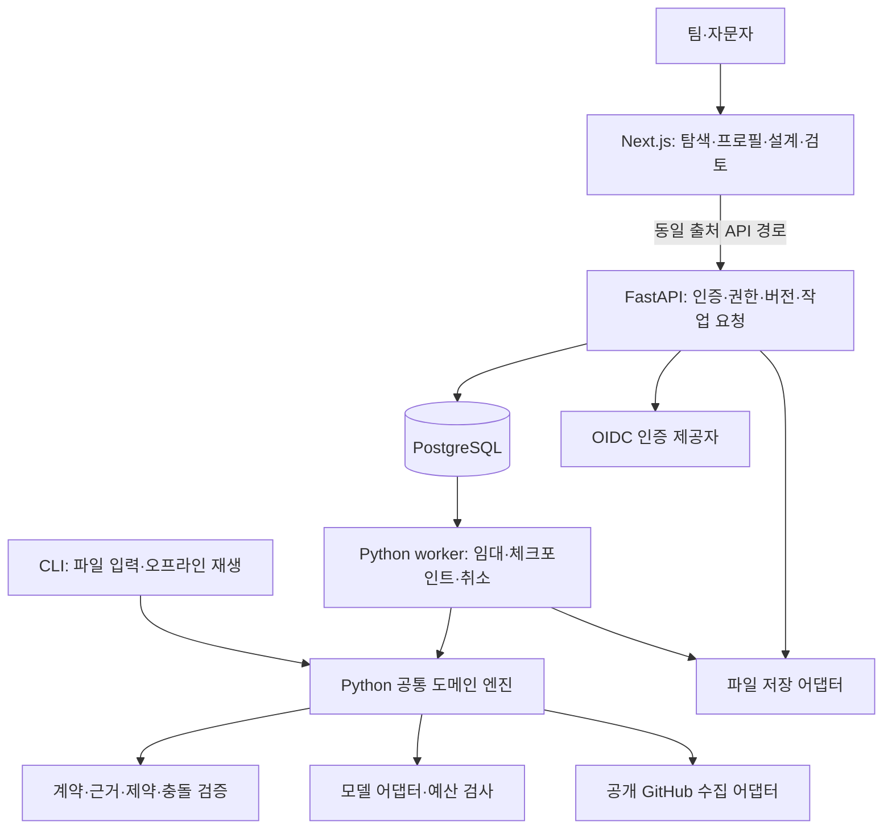

# 플랫폼 구현 설계 v0.3

작성일: 2026-10-23 (Asia/Seoul)

상태: 구현 기준안. 라이브러리·CLI·웹·서버·DB·모델 연결은 아직 구현하지 않았다. 기존 자료는 연구와 제품의 기획이며 실제 저장소 분석 결과는 아직 없다. 기능 요구는 [제품 명세](../product/WORKFLOW_COMPOSER.md), 데이터 의미는 [공통 계약](../specs/WORKFLOW_CONTRACTS.md), 품질 기준은 [평가 계획](../quality/EVALUATION.md)을 따른다.

## 1. 결정 요약

**Python으로 분석·검증·추천의 공통 엔진을 만들고, FastAPI와 Next.js로 웹 플랫폼을 얹는다.** 팀 직접 사용·자문·함께 사용 세 모드는 동일한 데이터와 엔진을 사용한다. 화면과 검토 흐름은 모드에 따라 달라지고, 접근 권한은 별도로 검사한다.

처음에는 모듈형 모놀리스로 개발한다. API와 워커는 같은 Python 패키지를 별도 프로세스로 실행하며, 서비스별로 도메인 로직을 복제하지 않는다. 웹은 서버의 구조화된 제안을 보여주고 수정 요청을 보낸다. 브라우저가 최종 제약 판정이나 고객 접근 권한을 결정하지 않는다.

## 2. 기술 스택 기준안

| 영역 | 선택 | 선택 이유·역할 | 도입 시점 |
| --- | --- | --- | --- |
| 웹 | Next.js App Router + React + TypeScript | 공개 연구 탐색과 로그인 작업 화면을 한 앱으로 제공 | 플랫폼 P1 |
| UI | Tailwind CSS + 접근성 있는 공통 컴포넌트 | 표·폼·근거 패널·상태·버전 비교의 일관성 | P1, 라이브러리 호환성 확인 후 고정 |
| 흐름 편집 | React Flow, 내보내기 Mermaid | 단계·전이·예외와 검사 위치 표시. 표 형식 편집도 함께 제공 | P2 |
| API | Python + FastAPI | 기존 연구 도구·도메인 엔진을 API·CLI·워커에서 재사용 | P1 |
| 계약 | Pydantic + JSON Schema, OpenAPI 생성 | Python 도메인 모델에서 API 계약·TypeScript 타입 생성 | 엔진 및 P1 |
| DB | PostgreSQL | 근거 계보, 버전, 고객 권한, 작업 상태·비용을 트랜잭션으로 관리 | P1 |
| DB 접근 | SQLAlchemy + Alembic | 명시적 트랜잭션·스키마 마이그레이션 | P1 |
| 장시간 작업 | 별도 Python worker + PostgreSQL 작업 테이블 | 초기 규모에서 추가 메시지 브로커 없이 재개·재시도·진행 기록 | P1, 아래 신뢰성 조건 충족 필요 |
| 파일 | 로컬 볼륨 어댑터 / S3 호환 오브젝트 저장소 | 원본·원 응답·내보내기 대용량 파일과 DB 메타데이터 분리 | 로컬 P1, 호스팅 P3 |
| 로그인 | OIDC, 자체 운영 참조 IdP는 Keycloak | 기업 IdP 연동과 자체 호스팅 선택 제공. 역할은 앱 DB에서 관리 | 다중 사용자 P2 |
| 모델 | 공급자별 Python 어댑터 + 저장 응답 재생 | generate / propose_patch / explain, 모델 변경과 오프라인 재현 | 엔진 및 P1 |
| 테스트 | pytest, Playwright, 계약·격리·워커 통합 시험 | 도메인 판정과 브라우저 사용자 흐름을 별도로 검증 | 단계별 |
| 배포·관측 | Docker Compose, 구조화 로그, OpenTelemetry | 자체 운영 패키지와 API→워커 실행 추적 | P1~P3 |

선택은 프로젝트 제약을 고려한 설계 판단이며 성능 측정 결과가 아니다. 메이저·마이너·패치 버전은 구현 착수 시 지원 상태·보안 수정·상호 호환성을 확인한 뒤 lockfile과 이미지 digest로 고정한다. 문서의 `latest`를 빌드 설정으로 사용하지 않는다.

비교한 대안은 다음과 같다.

| 대안 | 장점 | 이번 기준안에서의 판단 |
| --- | --- | --- |
| TypeScript 단일 서버 | 언어·배포 단순화 | 연구 계산·Python 도구와 도메인 중복 가능성을 고려해 Python 엔진 선택 |
| Django 중심 | 인증·관리 화면·ORM 통합 | 유효한 대안. 현재는 파일 엔진과 비동기 작업 API 경계를 우선해 FastAPI 선택 |
| 관리형 백엔드 일체형 | 초기 운영 부담 감소 | 빠른 호스팅 옵션이나 자체 운영·교체 가능성을 유지하도록 DB·파일·IdP 경계 분리 |
| 그래프 DB·전용 벡터 DB | 특화 탐색에 유리 | 초기 6~10개 관행에는 관계형 참조·필터가 충분한지 먼저 평가 |
| Kubernetes·서비스 분할 | 대규모 독립 운영 | 초기에는 Compose와 API/worker 분리로 시작, 병목 측정 후 검토 |

## 3. 시스템 구조



CLI는 도메인 엔진을 직접 호출하고 DB 없는 파일 모드를 지원한다. 웹 API가 DB에 기록하는 작업을 실행하는 워커도 같은 함수를 쓴다. DB의 행·화면 전용 상태를 도메인 객체에 섞지 않는다. 모델에 DB 자격증명·파일 쓰기 권한·임의 도구 실행 권한을 전달하지 않는다.

웹·API는 같은 origin의 reverse proxy 뒤에 배치한다. 브라우저는 HttpOnly·Secure 세션 쿠키를 사용하고, OIDC 토큰은 서버에서 관리한다. API가 세션과 workspace 권한을 확인한다. 상태 변경 요청에는 CSRF 방어·출처 검사를 적용한다. Python이 로그인·세션의 주체이며 Next.js는 이를 별도 권한 체계로 재구현하지 않는다.

## 4. 화면과 사용자 동선

| 화면 | 사용자가 하는 일 | 서버가 보장할 내용 |
| --- | --- | --- |
| 연구 탐색 | 회사·분야·프로젝트·기간으로 보고서·근거 확인 | 출처·버전·예비/검토 상태 표시, private 자료 미노출 |
| 관행 라이브러리 | 문제·전제·비용·근거 수준으로 후보 비교 | 원본 관행·변형·신규 가설 구분 |
| 팀 진단 | 목표·현재 단계·정책·역할·시간 입력 | unknown 보존, 필수 입력과 가정 분리 |
| 워크플로우 스튜디오 | 3대안·그래프·표·비용·근거 비교 | 정상·예외 경로의 전체 검사와 보류 이유 |
| 대화·diff | 변경 요청, 잠금, 변경 반영·거절 | 기준 revision 확인, 잠금·제약 재검사 |
| 검토·인수인계 | 자문 의견·수정 요청·검토 범위 기록 | 특정 revision 검토, 모드 전환으로 검토 상태 승격 금지 |
| 실행·내보내기 | 작업 진행·비용·오류 확인, 파일 받기 | 상태와 산출물 일치, tenant별 파일 접근 검사 |
| 운영 콘솔 | 공개 수집·카탈로그 승격·평가·비용 관리 | 일반 사용자와 운영자 권한 분리 |

연구 탐색에서 관행을 골라 팀 설계에 추가할 수 있다. 제외한 모듈도 이유와 함께 보존한다. 채팅만으로 결과를 제시하지 않고 구조화된 단계·역할·근거·검사 결과가 중심이 된다. 그래프 이동 같은 화면 배치는 절차 변경과 다른 이력으로 저장하며, 엣지·역할 변경은 도메인 patch로 검사한다.

## 5. 저장 구조와 고객 격리

| 테이블 묶음 | 핵심 데이터·관계 |
| --- | --- |
| research | repositories, snapshots, events, evidence, claims. repository/snapshot/event와 내용 해시로 수집 중복 방지 |
| catalog | patterns, pattern_versions, pattern_claims, pattern_relations, catalog_releases. 모듈 관계도 버전 고정 |
| access | users, workspaces, memberships, engagement_access, sessions. 사용 모드와 역할을 별도 필드로 관리 |
| design | team_profiles, profile_versions, proposals, proposal_revisions, revision_patterns, locks |
| review | reviews, review_scopes, handoffs, trials. proposal revision과 검토자·증거를 연결 |
| execution | jobs, job_events, run_steps, model_calls, budget_reservations, artifacts, audit_events |

도메인 객체의 버전 payload는 JSONB로 보존하되 workspace·revision·상태·참조·기간처럼 조회와 무결성에 필요한 값은 컬럼·FK·인덱스로 관리한다. proposal revision은 append-only이며 현재 포인터 갱신은 비교 후 쓰기로 처리한다. DB 마이그레이션과 도메인 스키마 버전은 별도 관리한다.

workspace_id는 모든 고객 소유 행과 작업·파일에 적용한다. 실제 권한 범위는 workspace와 engagement 양쪽을 확인한다. 자문자는 명시적으로 초대된 engagement에만 접근하며 모드가 advisory라는 이유로 전체 고객 자료에 접근할 수 없다. owner/editor/reviewer/viewer 역할과 운영 권한을 나눈다. 독립 검토자가 없는 경우 시스템은 사람 검토 게이트를 자동 충족시키지 않는다.

PostgreSQL RLS를 API 검사와 함께 적용한다. 런타임 역할은 superuser·BYPASSRLS·테이블 소유자와 분리하고 필요한 테이블은 FORCE RLS를 검토한다. tenant context는 요청/작업별 트랜잭션 범위에서 설정·해제하여 커넥션 풀에 남지 않게 한다. 고객 소유 참조는 workspace 포함 복합 FK 등으로 교차 연결을 차단한다. public 연구는 별도 schema·권한으로 읽으며 private→public 승격은 명시적 검토 작업으로만 수행한다. [PostgreSQL RLS 문서](https://www.postgresql.org/docs/current/ddl-rowsecurity.html)

파일은 난수 ID·소유권·해시·분류를 DB에 기록한다. S3 호환 저장소는 비공개 버킷과 짧은 유효기간 다운로드 URL을 사용한다. URL을 발급하기 전에 소유권을 검사하며 파일 경로나 사용자 입력 URL을 직접 다운로드 키로 쓰지 않는다. 로컬 경로는 저장 루트 안으로 제한한다.

## 6. 비동기 작업과 장애 처리

수집·분석·제안·수정·내보내기는 HTTP 요청 수명과 분리한다. API는 DB 트랜잭션으로 job과 입력 버전을 저장하고 `202 + job_id`를 반환한다. FastAPI BackgroundTasks를 장시간 작업의 내구성 큐로 쓰지 않는다. [FastAPI의 작업 분리 안내](https://fastapi.tiangolo.com/tutorial/background-tasks/)

첫 구현의 작업 큐는 PostgreSQL이다. worker는 짧은 트랜잭션 안에서 `FOR UPDATE SKIP LOCKED`로 준비 작업을 점유하고 lease·attempt·fencing token을 갱신한 뒤 트랜잭션을 끝낸다. 네트워크·모델 호출 중 DB 잠금을 유지하지 않는다. [PostgreSQL SELECT 문서](https://www.postgresql.org/docs/current/sql-select.html)

- 상태: queued → running → succeeded / failed / cancelled. 입력 부족·검증 실패는 job 성공 여부와 분리한 도메인 결과로 표시한다.
- heartbeat와 lease 만료로 죽은 worker의 작업을 회수한다. 오래된 attempt의 완료 쓰기는 fencing token으로 거부한다.
- 모든 단계는 입력 해시·작업 유형·버전 기반 멱등 키와 체크포인트를 갖는다. 외부 모델 호출의 exactly-once를 보장하지 않는다.
- 모델 호출 전 예산을 원자적으로 예약하고 종료 후 사용량을 정산한다. 응답 저장 전 장애로 비용이 불명확하면 보수적으로 예약을 유지하고 운영 확인 후 해소한다. 자동 재호출은 중복 청구 가능성을 기록한다.
- 재시도는 일시 오류에만 제한 횟수·지수 backoff로 적용한다. 영구 오류·정책 위반·잘못된 입력은 재시도하지 않는다. 최대 시도 후 failed와 재개 지점을 남긴다.
- 취소는 협력적으로 다음 단계에서 중지한다. 외부 호출 취소가 불가능하면 비용 발생 여부와 결과 보관 상태를 표시한다.
- 상태 갱신과 job_event를 같은 트랜잭션으로 기록한다. 클라이언트는 GET 폴링을 기본으로 하고 필요 시 SSE와 마지막 이벤트 ID로 재연결한다.

초기 자체 큐의 lease·중복·복구·예약 정산은 구현 비용이다. 이 통합 시험을 통과하지 않으면 다중 사용자 호스팅을 열지 않는다. 작업 수·대기시간·재시도 병목이 측정되거나 복잡한 일정·분산 실행이 필요하면 작업 저장 계약을 유지하며 전용 큐/오케스트레이터로 이전한다. 시간만 보고 특정 규모까지 지원한다고 약속하지 않는다.

## 7. AI 추천 파이프라인

1. profile과 revision·잠금·예산을 고정하고 unknown 및 필수 제약을 정규화한다.
2. 공개 카탈로그와 해당 workspace 자료만 검색한다. 초기에는 구조화 필터·태그·관계 검색을 사용한다.
3. 코드가 의존·충돌·필수 역할·시간 범위로 불가능한 후보를 제거한다. 후보와 제거 이유를 저장한다.
4. 모델은 고정 evidence/claim/pattern ID만 참조해 구조화된 대안이나 patch를 반환한다. 자연어에서 숫자 지표를 꾸며 채우지 않는다.
5. Pydantic 구조 검사와 별도 의미 검증기가 경로·잠금·역할·정책·참조를 검사한다. 형식 오류 수선은 제한 횟수로만 수행한다.
6. 의미가 불명확한 근거와 효과 설명은 검토 항목으로 표시한다. 유효 대안 부족·정보 부족·충돌을 도메인 결과로 반환할 수 있다.
7. 검증된 구조에서 제안서·그래프·diff를 생성한다. 사용자 반영 전 preview와 저장 revision을 구분하고 base revision이 바뀌면 409를 반환한다.

모델 공급자는 초기 평가로 선정하며, 모델명만 바꿔 무검증 자동 전환하지 않는다. 어댑터는 구조화 출력·사용량·timeout·오류·데이터 처리 조건을 선언한다. 모델 키는 서버/worker만 보유한다. 고객별 외부 전송 허용 범위와 호출 예산을 실행 전에 확인한다.

6~10개 모듈에는 임베딩·벡터 DB를 필수로 넣지 않는다. 검색 누락이 평가에서 확인되면 PostgreSQL의 pgvector를 선택적으로 도입하고 embedding 모델·차원·문서 버전·tenant 필터를 고정한다. 한국어 검색은 영어 중심 어간 처리에 의존하지 않고 사람이 라벨링한 한국어 질의로 비교한다. [pgvector 공식 저장소](https://github.com/pgvector/pgvector)

초기 흐름은 명시적 Python 상태 전이로 구현한다. 에이전트가 임의 도구·하위 작업을 만드는 방식을 기본으로 하지 않는다. 외부 문서의 지시문은 데이터로만 취급한다. 표준 모델 응답을 저장해 재생하는 모드와 새로운 모델 호출은 구분한다.

## 8. API 경계

아래는 구현할 경로 초안이다. 공통 응답에는 request_id와 권한 범위 내 식별자만 포함한다.

| 경로 | 의미·검사 |
| --- | --- |
| GET /v1/catalog/patterns | 공개·허용된 모듈 조회, 필터·cursor 페이지네이션 |
| GET /v1/research/claims/{id} | 근거와 문서 위치·버전, 공개 여부 검사 |
| POST /v1/workspaces/{id}/profiles | 프로필 검증·버전 생성 |
| POST /v1/workspaces/{id}/proposals | Idempotency-Key + profile_version + mode + budget → job |
| POST /v1/proposals/{id}/patch-previews | base_revision + request + locks → 검증된 preview job |
| POST /v1/proposals/{id}/revisions | preview_id + base_revision으로 원자적 반영, 충돌 시 409 |
| POST /v1/revisions/{id}/reviews | 검토 범위·결론 기록, reviewer 권한·대상 revision 검사 |
| POST /v1/revisions/{id}/exports | 형식·분류·검증 상태 검사 후 export job |
| GET /v1/jobs/{id}, /events | 소유권 확인 후 진행·재시도·비용·보류 이유 |
| POST /v1/jobs/{id}/cancel | 권한 확인 후 취소 요청 |

Idempotency-Key는 workspace·호출자·동작 범위에서 고유하며 같은 키에 다른 입력이 오면 거부한다. API 검증 오류, 접근 오류, revision 충돌, 예산 부족, 시스템 실패와 추천 보류는 별도 코드로 표현한다. 고객 리소스의 접근 불가 응답에서 타 고객 존재를 노출하지 않는다.

API OpenAPI와 JSON Schema에서 TypeScript 클라이언트를 생성하고 CI에서 계약 차이를 검사한다. 브라우저 검증은 편의 기능이며 Python 의미 검증이 최종 판정이다.

## 9. 배포와 운영 옵션

세 사용 모드와 배포 옵션은 독립적인 선택이다.

| 배포 옵션 | 구성 | 용도·조건 |
| --- | --- | --- |
| 로컬 CLI | Python 엔진 + 파일·재생 응답 | 개인 연구·오프라인 평가. 고객 자료가 자동 업로드되지 않음 |
| 자체 운영 웹 | Compose: reverse proxy, web, api, worker, PostgreSQL, 선택 IdP·파일 저장 | 팀 또는 자문 조직 내부 운영. 단일 조직 운영 책임 필요 |
| 호스팅 플랫폼 | web/api/worker 컨테이너 + 관리형 PostgreSQL + private 오브젝트 저장 + OIDC | 운영 백업·복구·고객 격리 gate 통과 후 제공 |

호스팅의 초기 참조 배치는 단일 리전이다. 관리형 DB와 파일 저장, 컨테이너 실행 환경은 제품 계약과 분리하여 특정 클라우드로 고정하지 않는다. GitHub Actions는 검사·이미지 빌드, staging 배포와 smoke 검사를 실행하고 운영 배포는 릴리스 절차에 따라 수행하도록 기획한다. 현재 인프라를 생성하거나 비용을 발생시키는 단계는 아니다.

DB 백업과 파일 버전을 함께 복구할 수 있게 manifest를 연결한다. 복구 훈련·마이그레이션 실패·작업 중 재시작·비밀키 교체를 출시 전에 확인한다. RPO/RTO·보존 기간·가용성 목표·삭제 소요 기간은 파일럿 측정과 이용 조직 요구를 보고 확정하며 미측정 SLA를 광고하지 않는다.

로그·trace에는 request_id/run_id/job_id를 연결하고 토큰·고객 원문을 남기지 않는다. 핵심 지표는 큐 대기, 완료·실패·보류, lease 회수, 모델 사용량·예약 잔액, 검사 실패, 고객별 저장량·추정 운영 부담이다. 공개 합성 예제·스냅샷 재생으로 관측 시스템도 검증한다.

## 10. 저장소 구조와 기술 부채 관리

아래는 구현 예정 구조이며 현재 디렉터리가 존재한다는 뜻이 아니다.

```text
apps/web/                    # Next.js, studio·탐색·검토
services/api/                # FastAPI, 세션·권한·job 요청
services/worker/             # 작업 점유·체크포인트·실행
packages/workflow_core/      # Python 계약·추천·검증·diff, 웹 의존 없음
packages/research/           # 수집·정규화·표본·통계
packages/adapters/           # 모델·저장·GitHub 경계
packages/contracts/          # 생성 JSON Schema·OpenAPI·TS 타입
cli/                         # 파일 기반 실행·재생
migrations/                  # Alembic
tests/                       # 도메인·계약·DB격리·워커·E2E
deploy/                      # Compose·환경 예시·운영 안내
evals/                       # 고정 평가 runner·manifest
```

TypeScript는 pnpm lockfile, Python은 선택한 의존성 관리 도구의 lockfile로 고정한다. CI에서 언어별 빌드·타입·lint와 계약·통합 시험을 나눈다. 기능 요구와 무관한 프레임워크를 먼저 도입하지 않는다. 모듈 관계·상태 의미·모델 어댑터 변경은 평가 영향과 마이그레이션을 설계 결정 기록에 남긴다.

## 11. 구현 순서와 완료 기준

플랫폼은 기존 20주 공통 엔진 계획에 추가되는 범위다. **공통 엔진 이후 약 14주·140~210시간을 잠정 배정**하며 독립 검토·실제 팀 대기와 클라우드 비용은 별도다. 연구·엔진과 병행할 수 있는 작업은 재산정하고 두 추정을 무조건 더한 고정 납기를 약속하지 않는다.

| 단계 | 배정 | 실행 범위 | 완료 조건 |
| --- | --- | --- | --- |
| P1 수직 구현 | 2주·20~30시간 | 합성 모듈 2개, 프로필 입력→job→검사→결과 화면 | worker 재시작 후 이어 실행, 원출력 재생. localhost 단독 사용자만 |
| P2 작업 플랫폼 | 4주·40~60시간 | 인증·권한·3모드·대안·그래프/표·diff·리뷰 | 타 workspace 접근·잠금 위반·revision 충돌 차단, 세 모드 동선 검증 |
| P3 파일럿 운영 | 4주·40~60시간 | 파일 권한·예산·복구·작업 장애·내보내기·자체 운영 패키지 | 장애·취소·재시도·중복 호출·예약 정산·백업 복구 시험 |
| P4 출시 평가 | 4주·40~60시간 | 근거 연결 실데이터·품질 평가·staging·문서 | 기존 품질 gate와 플랫폼 gate별 결과 공개, 미달은 alpha 유지 |

첫 P1은 전체 연구를 기다리지 않고 합성 데이터로 계약을 검증할 수 있다. 그 결과를 실제 회사 분석이나 제품 효과로 표시하지 않는다. P1 종료 시 개발 속도·DB 큐 구현 비용·UI 부담을 측정해 P2~P4 예산을 다시 산정한다.

플랫폼 출시 전 추가 필수 시험은 (1) workspace/engagement/파일/검색/worker 교차 접근, (2) 쿠키·CSRF·로그아웃, (3) 작업 임대 만료와 오래된 worker 쓰기 차단, (4) 멱등·동시 예산 예약, (5) revision·검토 상태 일관성, (6) 내보내기와 화면·정의 일치, (7) 키보드·표 편집·근거 접근, (8) 백업 복구·마이그레이션이다. 통과 결과는 아직 없다.

## 12. 공식 기술 참고 자료

확인일은 2026-10-23이다. 문서의 기능 설명을 참고해 선택한 기준안이며, 본 서비스의 성능이나 구현 완료를 입증하는 자료가 아니다.

- [Next.js App Router](https://nextjs.org/docs/app), [React Flow](https://reactflow.dev/learn): 화면·그래프 설계.
- [FastAPI async](https://fastapi.tiangolo.com/async/), [Pydantic JSON Schema](https://docs.pydantic.dev/latest/concepts/json_schema/): API·계약 경계.
- [SQLAlchemy](https://docs.sqlalchemy.org/), [Alembic](https://alembic.sqlalchemy.org/en/latest/): 트랜잭션·마이그레이션.
- [Keycloak OIDC](https://www.keycloak.org/securing-apps/oidc-layers): 자체 운영 인증 참조 구현.
- [Docker Compose](https://docs.docker.com/compose/), [OpenTelemetry](https://opentelemetry.io/docs/), [Playwright](https://playwright.dev/docs/intro): 패키징·관측·E2E.
