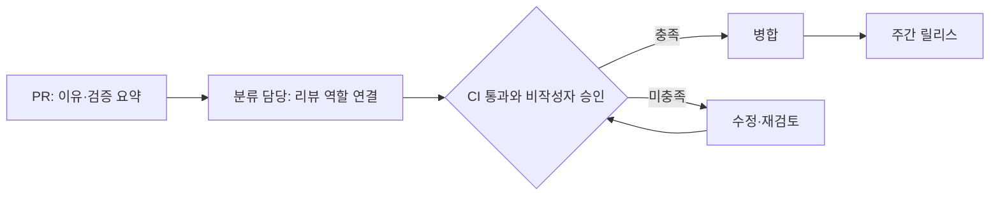

# 가상 예시: 여러 관행을 조합하고 팀 상황에 맞게 수정하기

**기능 검토용으로 사람이 작성한 합성 예시다. 구현된 AI의 출력·실제 회사의 관행·고객 성과가 아니다.** 아래 모듈은 모두 가상이며 실제 근거 카탈로그에 포함하지 않는다. 사용 모드는 A·B·C 어느 것을 선택해도 같은 설계 규칙을 따른다.

## 1. 입력

| 항목 | 가정한 입력 |
| --- | --- |
| 대상 | 8명 제품 팀, 단일 저장소, 주 1회 릴리스 |
| 해결할 문제 | 리뷰 요청이 묻힘. 변경 이유가 부족해 추가 설명을 반복 요청함 |
| 현재 과정 | PR 작성→리뷰어 지정→CI와 리뷰→병합→주간 릴리스 |
| 역할 | 작성자 외 승인 가능한 사람 2명. 두 역할을 수행할 실제 사람이 있는지 별도 확인 |
| 필수 조건 | 모든 변경에 비작성자 승인 1명과 CI 통과. 긴급 변경도 동일 |
| 잠금 | 주 1회 릴리스 유지, 새로운 유료 도구 추가 금지 |
| 반복 부담 상한 | 전체 팀 주당 추가 120분 |
| 일회성 도입 상한 | 4시간 |
| 가정한 건수 | 관련 PR 주 10건. 실제값을 확보하기 전에는 가정으로 표시 |

원하는 출처 프로젝트는 사용자가 여러 개 선택할 수 있다. 실제 구현에서는 각 관행 카드에 프로젝트·기간·버전·관찰 근거가 붙는다. 이 합성 예시는 회사명을 붙이지 않는다.

## 2. 가상 모듈과 비용 추정

모든 시간은 동작 설명용 가정이며 업무 절감 시간이나 실측 비용이 아니다.

| ID | 모듈 | 조건·관계 | 추가 반복 부담 | 일회성 도입 |
| --- | --- | --- | --- | --- |
| DEMO-A | 리뷰 요청 분류 담당 순환 | 승인 정책은 보존. 담당 공백 시 대리 필요 | 주당 30~40분 | 30~45분 |
| DEMO-B | PR에 변경 이유·검증 요약 작성 | 모든 PR에 적용. 승인·CI를 대체하지 않음 | 10건 × 2~3분 = 20~30분 | 30~45분 |
| DEMO-C | 고위험 변경의 릴리스 점검 | 위험 분류·점검 담당 필요, 주 2건 가정 | 2건 × 10~15분 = 20~30분 | 60~90분 |
| DEMO-X | 저위험 변경은 승인 없이 병합 | 비작성자 승인 1명 필수 규칙과 충돌 | 계산 전 제외 | 계산 전 제외 |

실제 조합은 ‘이점이 있어 보인다’는 판단 이후에도 의존·충돌·역할 가용성을 확인한다. `DEMO-X`는 어떤 대안에도 선택하지 않는다. 연결 자체의 효과는 별도 가설이다.

## 3. 세 추천 대안

| 대안 | 가상 조합 | 주당 추가 부담 | 도입 부담 | 기대하는 점과 남는 한계 |
| --- | --- | --- | --- | --- |
| 최소 변경 | A | 30~40분 | 30~45분 | 요청 누락 완화를 시험. 설명 부족 문제는 남음 |
| 균형 | A+B | 50~70분 | 60~90분 | 요청 분류와 설명 왕복을 함께 다룸. 효과 원인 분리는 어려워 순차 도입 |
| 통제 강화 | A+B+C | 70~100분 | 120~180분 | 고위험 점검을 추가. 더 많은 운영 부담이 있어 필요 위험부터 확인 |

예시 입력에서 세 안은 시간 상한 안에 있다. 필수 승인·CI·릴리스 잠금은 모두 유지한다. 실제 가용성 확인 전에는 `transfer_status: conditional`, `advisory_review_status: draft`다. 시간 합계만으로 실행 가능성 전체를 확정하지 않는다.

권장 초안은 균형안으로 하되 A부터 시험하고 B를 후속 도입하는 것이다. 이 결정은 가상 문제 두 가지를 다루면서 한 번에 여러 변수를 바꾸는 부담을 줄이기 위한 설계 가설이다. 품질이 가장 높다는 판정이나 개선율 예상은 아니다.

수정 루프에는 담당자, 재검토 요청, 장기 정체 시 상향 보고 조건을 정의해야 한다. 긴급 변경은 우선 배정하되 이 예시의 필수 승인·CI를 생략하지 않는다.

## 4. 팀 조건이 바뀐 경우

사용자 요청: “추가 업무는 주 60분까지로 줄여줘. 승인과 릴리스 주기는 유지해줘.”

균형안 A+B의 상한 70분은 새 한도 60분을 넘으므로 그대로 통과시키지 않는다. 최저 추정값 50분만 골라 적합하다고 표시하지 않는다.

AI가 제안할 수 있는 가상 수정은 B를 고위험 변경에만 적용하는 `B'`다. 고위험 주 2건 가정에서 B'의 추가 부담은 주 4~6분이다. A+B'는 주 34~46분, 일회성 도입은 60~90분으로 추정한다. **B'는 AI가 새로 변형한 가설**이며 원 모듈이나 다른 회사의 실측 효과를 승계하지 않는다.

| 항목 | 이전 | 수정 제안 |
| --- | --- | --- |
| 변경 이유·검증 요약 | 모든 PR | 고위험 PR에 우선 적용 |
| 위험 판정 | 별도 역할 미정 | 기존 작성자가 초안 분류, 기존 리뷰어가 확인할 수 있는지 질문 |
| 추가 반복 부담 | 주 50~70분 | 주 34~46분 + 위험 분류에 드는 미측정 시간 |
| 필수 승인·CI | 유지 | 유지 |
| 릴리스 | 주 1회 | 주 1회 유지 |
| 검토 상태 | 초안 | 새 revision, 초안·조건부 유지 |

위험 분류 시간이 없으므로 새 합계도 최종 확정이 아니다. 주당 남는 14분 안에 위험 분류·이견 처리가 가능한지 확인하거나, 먼저 A만 실행하는 안을 함께 제시한다. 절차 하나를 줄였다고 새 부담이 사라진 것으로 계산하지 않는다.

후속 요청이 “승인 없이 바로 병합하도록 바꿔줘”라면 필수 정책 충돌을 설명하고 해당 변경을 반영하지 않는다. 팀 프로필의 정책이 공식적으로 바뀐 별도 입력이 있어야 새 기준으로 재설계할 수 있다.

## 5. 내보낼 결과

제안서, before/after diff, 역할·예외·미확인 항목, 가상 근거 표시, 버전별 검사 결과, 도입·기준선·관찰·중단 계획을 함께 내보낸다. 실제 설정을 적용했다고 표시하지 않는다.

실험은 기준선 확보 후 A 한 가지로 시작한다. 첫 비작성자 반응 시간, 요청 누락, 추가 업무 시간, 팀 체감 부담과 회귀 신호를 관찰한다. 사건 수가 부족하면 관찰을 늘리거나 판단을 보류한다. 이 문서는 그런 실험을 수행하거나 통과했다는 증거가 아니다.
