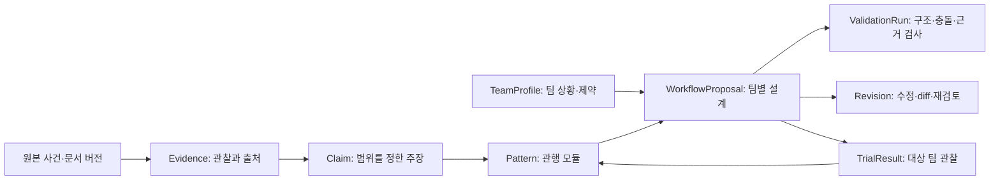

# 워크플로우 데이터·추천 계약 v0.2

상태: 구현 전 계약 초안. 이 문서의 필드·불변 조건을 기준으로 구현 단계에서 JSON Schema와 의미 검증기를 작성한다. 현재 실행 가능한 스키마나 검증기가 존재한다는 뜻은 아니다.

## 1. 객체와 근거의 연결

모든 객체는 `schema_version`, 고유 `id`, 불변 `version`, `created_at_utc`, `data_classification: public|private|synthetic`를 갖는다. 참조는 ID만 쓰지 않고 버전도 고정한다. 공개 연구 근거와 고객별 프로필·시험 결과는 저장 영역과 검색 인덱스를 분리한다.

## 2. 상태를 구분하는 네 축

| 축 | 값 | 의미 |
| --- | --- | --- |
| evidence_level | E0 / E1 / E2 / E3 | 출처 연결만 / 원 프로젝트 문서 규정 / 반복 관찰 / 대상 팀 시험 결과 존재 |
| effect_status | untested / feasibility_tested / target_trial_supported / inconclusive / contradicted | 효과 미검증 / 실행 가능성 점검 / 해당 시험 조건에서 지지 / 판단 부족 / 반대 결과 |
| transfer_status | unassessed / conditional / eligible / blocked / trial_supported | 적합성 미평가 / 조건부 / 현재 알려진 필수 제약 충족 / 위반 / 해당 팀 시험에서 조건부 지지 |
| advisory_review_status | draft / ai_checked / human_reviewed / target_trial_reviewed | 초안 / 자동 검사 / 사람의 자문 검토 / 대상 팀 시험까지 사람 검토 |

E0는 출처가 연결됐다는 뜻이며 해당 주장이 맞다는 뜻은 아니다. 새로 만든 AI 가설은 `origin: ai_proposed`, `evidence_level: null`로 두며 실제 회사 관행으로 등록하지 않는다. E1과 E2는 문서 규정과 관찰이 서로 다를 수 있으므로 `source_policy_present`와 `repeated_observation_present`도 각각 남긴다. E3도 긍정적 효과를 보장하지 않는다.

근거 상태는 Claim·Pattern에, 효과 상태는 시험 범위를 연결한 Pattern·TrialResult에, 적합성·자문 상태는 **각 팀 제안과 그 revision**에 붙인다. 이전 제안의 검토 상태를 새 제안에 그대로 복사하지 않는다. 재검토 범위를 표시하고 최종 확인 전에는 `draft` 또는 `ai_checked`로 되돌린다.

`confidence`를 추가한다면 서술 이유·관찰량·누락·반례와 연결한다. 모델이 말한 ‘신뢰도 95%’를 실측 확률처럼 사용하지 않는다.

## 3. TeamProfile

| 필드 | 형식·내용 | 처리 규칙 |
| --- | --- | --- |
| team, product | 인원, 역할, 제품 유형, 운영 형태, 서비스 중요도 | 값별 출처: user_supplied / imported / inferred / unknown |
| current_workflow | 단계·담당·트리거·이동 조건·예외 | 현행 절차가 없으면 개선 diff 대신 신규 설계로 표시 |
| goals | 해결할 문제, 관찰한 기준선, 우선순위·측정 방법 | 문제 진술과 AI 병목 가설을 분리 |
| capabilities | CI, 테스트, 관측, 배포·복구 기능, 사용 도구 | 지원 여부 unknown을 false로 바꾸지 않음 |
| role_capacity | 역할별 가용 인원·주당 가용 시간·겸임 관계 | 인원만으로 실제 검토 가능성을 추정하지 않음 |
| hard_constraints | 금지·필수 규칙, 릴리스 창, 역할 분리 등 | ID, 구조화 조건, 출처, 확인자, 변경 가능 여부 |
| preferences | 변경 최소화·속도·안정성·유지비 등의 선호 | 필수 규칙보다 우선하지 않음 |
| source_preferences | 포함·제외할 프로젝트·기간·근거 수준 | 회사 선택이 필수 제약을 덮어쓰지 않음 |
| budget | 도입·운영 시간과 모델 실행 비용 상한 | 미입력은 unknown. 모델 비용 상한은 실행 전에 확정 |
| open_questions, assumptions | 미확인 정보와 임시 가정 | 필수 조건에 영향을 주면 최종 적합 판정을 보류 |

제품 중요도·필수 규칙·필수 역할 가용성이 불명확하면 AI가 임의로 채워 실행 가능한 최종안으로 내보내지 않는다. 예비 대안과 필요한 질문은 제시할 수 있다.

## 4. Evidence와 Claim

Evidence의 필수 항목은 `source_url`, `repository_id`, `event_id|document_sha`, `event_at_utc|document_as_of`, `fetched_at_utc`, `snapshot_utc`, `content_hash`, `locator`, `visibility`, `origin`이다. 해당하지 않는 값은 이유와 함께 null로 남긴다. `locator`는 문서 절·라인 또는 사건 위치를 가리킨다. `origin`은 `public_source|user_supplied|synthetic`다.

Claim은 `statement`, `claim_type: policy|observation|interpretation|effect_hypothesis|trial_finding`, `evidence_refs`, `population`, `sample`, `period`, `missingness`, `counterevidence_refs`, `alternative_explanations`, `review_record`를 갖는다.

서로 같은 변경에서 나온 여러 리뷰는 독립 사례 하나로 센다. 링크 존재·접근 가능성과 주장에 대한 지지는 별도 검사다. `synthetic` Evidence는 제품 예시에만 쓰며 공개 연구·자문 근거 검색에서는 제외한다.

## 5. Pattern: 재사용 가능한 관행 모듈

| 필드 묶음 | 내용 |
| --- | --- |
| identity | 이름, 문제, 카테고리, origin: observed / documented / ai_proposed, 버전·유효 시점 |
| provenance | claim_refs, evidence_level, 원 프로젝트와 운영 맥락, 현재 규정 여부 |
| mechanism | 실제 관찰, 효과를 기대하는 이유, expected_benefit_hypothesis, 알려진 부작용 |
| applicability | 필요한 팀·제품·역할·도구·성숙 조건, 적용 제외 조건 |
| behavior | 트리거, 입력, 단계, 역할, 완료 조건, 예외·긴급 경로 |
| composition | requires, conflicts_with, alternatives, provides. 관계마다 이유와 근거·가정 표시 |
| parameters | 조절 가능한 값·범위·단위·기본값 출처·변경 불가 조건 |
| workload | 도입 시간, 주당 운영 시간, 역할별 부담, 추정 범위·근거 |
| measurement | 관찰 지표·분모·기준선·실험 기간·중단·복구 조건 |
| limitations | 공개 범위, 효과 상태, 원 프로젝트와 대상 팀의 차이, 검토 상태 |

예: ‘위험별 리뷰’는 프로젝트 하나의 전체 개발 방식을 복사하는 단위가 아니다. 위험 분류·승인 조건·긴급 예외를 매개변수로 정의하고, 대상 팀의 필수 승인 규칙을 보존하는 범위에서 바꾼다. 특정 회사가 이 관행을 실제 사용한다는 주장은 별도 근거가 필요하다.

## 6. WorkflowProposal과 Revision

| 필드 | 필수 결과 |
| --- | --- |
| provenance | team_profile_ref, pattern_catalog_version, run_id, 모듈별 원본·변형 버전 |
| use_mode | self_service / advisory / hybrid. 사용자 선택이며 품질 우열 아님 |
| alternative_type | minimal_change / balanced / stronger_controls. 사용 모드와 독립 |
| choices | 채택·수정·제외한 모듈과 이유, 새로 만든 가설·조건 |
| workflow | 고유 단계 ID, 담당 역할, 입력·출력, 전이·조건, 예외·정상 종료·복구 경로 |
| changes | 추가·삭제·수정 단계, 정책·역할·업무량·설정 영향, before/after |
| assessment | 필수 제약 판정, 충돌·선행 조건·역할 부하, 미해결 질문·잔여 위험 |
| rollout | 도입 순서, 담당, 필요한 기능, baseline, 측정·복구 조건 |
| review | transfer_status, advisory_review_status, review_scope, reviewed_revision |

추가 승인을 무조건 안정성 향상으로 평가하거나 승인 제거를 무조건 속도 개선으로 평가하지 않는다. 효과 예상치는 가설과 방향으로 설명하고, 원 데이터가 없으면 개선율을 만들지 않는다.

Revision은 `parent_revision`, `requested_change`, `locked_fields`, `patch`, `rationale`, `affected_claims`, `validation_run_ref`, `review_invalidated_scope`를 남긴다. 사용자가 잠근 조건과 충돌하는 요청이면 자동 해제하지 않고 충돌을 설명한다. 반복 수정 후에도 profile·잠금·전체 제약을 다시 검사한다.

## 7. 코드로 검사할 불변 조건

1. ID·버전 참조가 모두 해소되고, 단위·상태·필수 필드가 유효해야 한다.
2. 필수 제약 판정은 `pass|fail|unknown`의 세 값이다. unknown은 통과가 아니다.
3. 채택 모듈의 requires를 제공하는 단계·기능이 있고 conflicts_with가 해소되어야 한다.
4. 승인·릴리스·긴급 경로를 포함한 모든 전이에서 필수 조건을 확인한다. 예외가 필수 규칙을 우회하지 않아야 한다.
5. 시작점에서 필수 단계·정상 종료·예외 종료가 도달 가능해야 한다. 재작업 루프에는 종료·상향 보고 조건이 있어야 한다. 워크플로우를 무조건 DAG로 제한하지 않는다.
6. 필수 역할이 배정되고, 작성자와 승인자의 분리 조건·가용성·주당 시간 상한을 충족해야 한다. 부하는 추정 범위로 합산하고 근거 없는 단일 수치로 정확도를 꾸미지 않는다.
7. `AI가 수정한 관행`은 바뀐 값·근거·가정을 남긴다. 원본 관행의 관찰 결과를 변형안의 실측 효과로 승계하지 않는다.
8. 알려진 필수 위반이나 필수 정보 unknown이 있으면 ‘검증 통과’ 최종안으로 내보낼 수 없다. 진단 초안 내보내기에는 실패·보류를 명시한다.
9. 출처 근거가 약해졌거나 정책이 바뀌면 해당 모듈을 쓰는 제안을 재검토 대상으로 표시한다. 과거 버전을 덮어쓰지 않는다.
10. 공개 패키지에는 private 객체나 기밀 입력을 포함하지 않는다. synthetic 객체는 식별 표시를 보존한다.

구조·참조·충돌·경로·정해진 수식은 코드로 검사한다. 문서가 주장을 지지하는지, 목표·부작용이 적절한지는 AI 보조와 사람 검토로 판정한다. 코드 통과가 자문 내용 전체의 타당성을 뜻하지 않는다.

## 8. ValidationRun과 재현

실행마다 입력·근거 해시, 모듈·정책·프롬프트·스키마·코드 버전, 모델 공급자·실제 모델 ID·파라미터, 검색 결과와 컨텍스트, 원 응답, 정규화 결과, 검사 결과, 지연·사용량·실제 비용 또는 산정 불가 이유를 남긴다.

기밀 데이터의 로그 정책은 팀 프로필과 함께 정하고 원문 중복 보관을 최소화한다. 구조화 선택 이유와 근거를 기록하며 모델의 비공개 사고 과정을 요구하지 않는다.

동일 고정 입력의 지표·표본·검사 결과는 재현 가능하게 만든다. 모델 재호출의 문장·선택이 비트 단위로 같다고 약속하지 않는다. 원 응답 재생과 새로운 생성은 별도 실행이며, 모델 변경 시 [평가 계획](../quality/EVALUATION.md)에 따라 비교한다.

입출력 구조의 구체 구현에는 [JSON Schema 공식 명세](https://json-schema.org/draft/2020-12)를 참고한다. 출처·변환·주체 연결은 [W3C PROV 개요](https://www.w3.org/TR/prov-overview/)를 참고한 설계이며 현재 표준 적합성을 인증한 것은 아니다.
